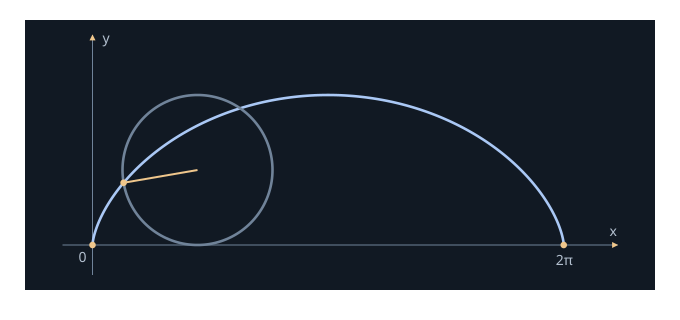
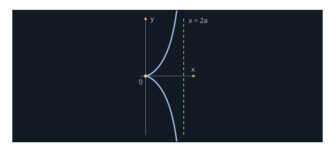
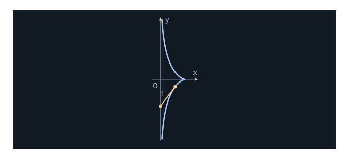
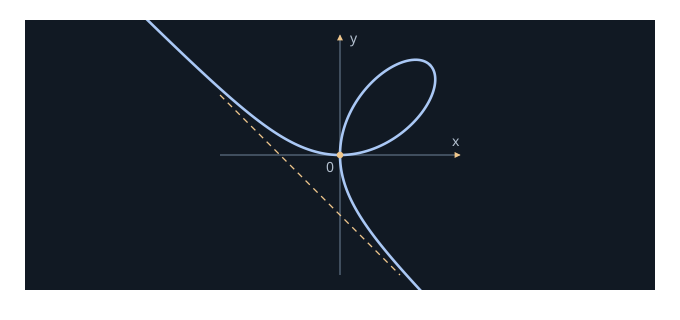
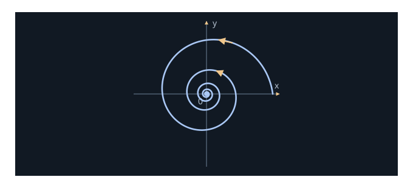
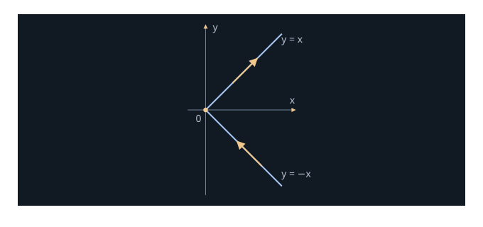

These exercises follow §1.3 of the reference book (printed pages 7–11), with wording adapted for these notes. Solutions use mathematical notation with brief explanations. Planar curves may be viewed in $\R^3$ by adding a zero third coordinate.

::: remark [1.3.1] Formula checks in the supplied pages
The formulas shown in Exercises 1, 3(c), and 4 do not match their stated conclusions. Each affected exercise explicitly records the discrepancy and the formula used in its solution; these checks are additions to the notes.
:::

<section class="note-exercise" aria-labelledby="exercise-1">
<h3 id="exercise-1">Exercise 1.3.1 · A constant angle with a fixed line</h3>

Show that the tangent lines to a regular curve make a constant angle with the line $y=0$, $z=x$.

**Formula check.** The supplied image gives $\alpha(t)=(3t,2t^2,2t^3)$, for which the assertion is false. The calculation below first checks that formula, then solves the version with $\widetilde\alpha(t)=(3t,3t^2,2t^3)$.

Solution

The fixed line has direction $v=(1,0,1)$. For the formula in the image,

$$\alpha'(t)=(3,4t,6t^2),\qquad \cos\theta(t)=\frac{3+6t^2}{\sqrt2\sqrt{9+16t^2+36t^4}}.$$

This is not constant: $\cos\theta(0)=1/\sqrt2$, whereas $\cos\theta(1)=9/\sqrt{122}$.

For the corrected version,

$$
\begin{aligned}
\widetilde\alpha'(t)&=(3,6t,6t^2),\\
\|\widetilde\alpha'(t)\|&=3(1+2t^2),\\
\cos\theta&=\frac{\widetilde\alpha'(t)\cdot v}{\|\widetilde\alpha'(t)\|\|v\|}=\frac{3+6t^2}{3(1+2t^2)\sqrt2}=\frac1{\sqrt2}.
\end{aligned}
$$

Hence the angle between the tangent line and the fixed line is $\pi/4$.

$\blacksquare$

</section>

<section class="note-exercise" aria-labelledby="exercise-2">
<h3 id="exercise-2">Exercise 1.3.2 · The cycloid</h3>

A unit disk rolls to the right along the $x$ axis without slipping. A marked point starts at the origin on the rim.

**(a)** Find a parametrization of its trace and all singular parameters. **(b)** Compute the length traced during one complete rotation.
<figure class="math-note-figure">

<figcaption>The unit cycloid: one rotation produces one arch.</figcaption>
</figure>

Solution

**(a)** Let $t$ be the clockwise rotation angle. No slipping gives center $C(t)=(t,1)$; the marked radius is $(-\sin t,-\cos t)$. Thus

$$\alpha(t)=(t-\sin t,1-\cos t),\qquad t\in\R.$$

Then

$$\alpha'(t)=(1-\cos t,\sin t)=0\iff t=2\pi k,\quad k\in\Z.$$

The corresponding cusp points are $(2\pi k,0)$.

**(b)** The speed is

$$\|\alpha'(t)\|=\sqrt{2-2\cos t}=2|\sin(t/2)|.$$

For one rotation,

$$L=\int_0^{2\pi}2\sin(t/2)\,dt=\left[-4\cos(t/2)\right]_0^{2\pi}=8.$$

The zero speed at the endpoints does not prevent this length integral from being evaluated.

$\blacksquare$

</section>

<section class="note-exercise" aria-labelledby="exercise-3">
<h3 id="exercise-3">Exercise 1.3.3 · The cissoid of Diocles</h3>

A circle has diameter $OA=2a$, with $a>0$, along the $x$ axis. A ray from $O$ meets the circle again at $C$ and the tangent line $x=2a$ at $B$. On the ray choose $P$ with $OP=CB$.

**(a)** With $t=\tan\theta$, derive

$$\alpha(t)=\left(\frac{2at^2}{1+t^2},\frac{2at^3}{1+t^2}\right),\qquad t\in\R.$$

**(b)** Show that $t=0$ is singular. **(c)** Show that the curve and its tangent approach $x=2a$ as $t\to+\infty$.

**Formula check.** The image states $\alpha'(t)\to(2a,0)$; direct differentiation gives $(0,2a)$.
<figure class="math-note-figure">

<figcaption>Cissoid for a = 1; the dashed line is the asymptote.</figcaption>
</figure>

Solution

**(a)** For $-\pi/2<\theta<\pi/2$, the circle equation is $r^2=2ar\cos\theta$. Therefore

$$OC=2a\cos\theta,\qquad OB=\frac{2a}{\cos\theta},\qquad OP=\frac{2a\sin^2\theta}{\cos\theta}.$$

Multiplying $OP$ by $(\cos\theta,\sin\theta)$ and substituting $t=\tan\theta$ gives the required formula. The horizontal case is understood by continuity at $t=0$.

**(b)** Differentiation gives

$$\alpha'(t)=\left(\frac{4at}{(1+t^2)^2},\frac{2at^2(3+t^2)}{(1+t^2)^2}\right).$$

Thus $\alpha'(0)=0$; all $t\ne0$ are regular.

**(c)** As $t\to+\infty$,

$$x(t)\to2a,\qquad y(t)\to+\infty,\qquad\alpha'(t)\to(0,2a).$$

The distance from the point to $x=2a$ is $2a/(1+t^2)\to0$.

For the tangent line, write

$$X-\frac{x'(t)}{y'(t)}Y=x(t)-\frac{x'(t)}{y'(t)}y(t).$$

Here

$$\frac{x'}{y'}=\frac{2}{t(3+t^2)}\to0,\qquad x-\frac{x'}{y'}y=\frac{2at^2}{t^2+3}\to2a.$$

Hence its limiting equation is $X=2a$.

$\blacksquare$

</section>

<section class="note-exercise" aria-labelledby="exercise-4">
<h3 id="exercise-4">Exercise 1.3.4 · The tractrix</h3>

For $0<t<\pi$, consider the tractrix

$$\alpha(t)=\left(\sin t,\cos t+\log\tan\frac t2\right).$$

**(a)** Prove that it is smooth and regular except at $t=\pi/2$. **(b)** At each regular parameter, prove that the tangent segment from the curve to the $y$ axis has length $1$.

**Formula check.** The image has $\cos t$ as the first coordinate. That formula is regular at $\pi/2$ and does not satisfy (b). We use $\sin t$, which agrees with the stated conclusions and the diagram.
<figure class="math-note-figure">

<figcaption>The corrected tractrix and a unit tangent segment.</figcaption>
</figure>

Solution

Since $\tan(t/2)>0$, both coordinates are smooth on $(0,\pi)$. Also,

$$\frac d{dt}\log\tan\frac t2=\frac1{\sin t}.$$

**(a)** Thus

$$\alpha'(t)=\left(\cos t,\frac{\cos^2t}{\sin t}\right)=\frac{\cos t}{\sin t}(\sin t,\cos t).$$

Consequently $\alpha'(t)=0\iff t=\pi/2$.

**(b)** If $t\ne\pi/2$, the tangent meets the $y$ axis at

$$Q(t)=\alpha(t)-\tan t\,\alpha'(t)=\left(0,\log\tan\frac t2\right).$$

Hence

$$\|Q(t)-\alpha(t)\|=\|(-\sin t,-\cos t)\|=1.$$

For comparison, using the first coordinate $\cos t$ from the image gives $\alpha(\pi/2)=(0,0)$ and $\alpha'(\pi/2)=(-1,0)$, contradicting both intended conclusions.

$\blacksquare$

</section>

<section class="note-exercise" aria-labelledby="exercise-5">
<h3 id="exercise-5">Exercise 1.3.5 · The folium of Descartes</h3>

For $a>0$, let

$$\alpha(t)=\left(\frac{3at}{1+t^3},\frac{3at^2}{1+t^3}\right),\qquad -1<t<+\infty.$$

**(a)** Show that the tangent at $t=0$ is the $x$ axis. **(b)** Show that $\alpha(t),\alpha'(t)\to(0,0)$ as $t\to+\infty$. **(c)** Reverse orientation and show that, as the original parameter tends to $-1^+$, the curve and tangent approach $x+y+a=0$.

Reflecting the trace across $y=x$ completes the folium.
<figure class="math-note-figure">

<figcaption>Completed folium for a = 1; the dashed line is x + y + 1 = 0.</figcaption>
</figure>

Solution

Differentiate:

$$\alpha'(t)=\frac{3a}{(1+t^3)^2}(1-2t^3,\ 2t-t^4).$$

**(a)** $\alpha(0)=(0,0)$ and $\alpha'(0)=(3a,0)$, so the tangent is the $x$ axis.

**(b)** Comparing degrees gives

$$\alpha(t)\to(0,0),\qquad \alpha'(t)\to(0,0).$$

**(c)** The curve approaches the line because

$$x(t)+y(t)+a=\frac{a(t+1)^2}{t^2-t+1}\to0\qquad(t\to-1^+).$$

In fact its distance to the line is $|x+y+a|/\sqrt2\to0$, while $|x|,|y|\to\infty$.

Near $t=-1$, the tangent has equation $Y=m(t)X+c(t)$, where

$$m(t)=\frac{2t-t^4}{1-2t^3}\to-1,\qquad c(t)=y(t)-m(t)x(t)=\frac{-3at^2}{1-2t^3}\to-a.$$

Thus the tangent also approaches $X+Y+a=0$. Reversing orientation via $\beta(u)=\alpha(-u)$ changes velocity signs, but not tangent lines or the asymptote.

$\blacksquare$

</section>

<section class="note-exercise" aria-labelledby="exercise-6">
<h3 id="exercise-6">Exercise 1.3.6 · A logarithmic spiral of finite length</h3>

Let $a>0$, $b<0$, and

$$\alpha(t)=(ae^{bt}\cos t,ae^{bt}\sin t),\qquad t\in\R.$$

**(a)** Show that $\alpha(t)$ spirals toward the origin as $t\to+\infty$. **(b)** Show that $\alpha'(t)\to0$ and compute the finite length on $[t_0,+\infty)$.
<figure class="math-note-figure">

<figcaption>A logarithmic spiral with decreasing radius and infinitely many turns.</figcaption>
</figure>

Solution

**(a)** In polar coordinates,

$$r(t)=ae^{bt}\to0,\qquad\theta(t)=t\to+\infty.$$

Thus the radius shrinks to zero while the angle increases through infinitely many turns.

**(b)** We have

$$\alpha'(t)=ae^{bt}(b\cos t-\sin t,\ b\sin t+\cos t),$$

so

$$\|\alpha'(t)\|=ae^{bt}\sqrt{1+b^2}\to0.$$

The improper length integral converges:

$$L=\int_{t_0}^{\infty}ae^{bt}\sqrt{1+b^2}\,dt=\frac{a\sqrt{1+b^2}}{-b}e^{bt_0}<\infty.$$

Infinitely many turns need not have infinite total length.

$\blacksquare$

</section>

<section class="note-exercise" aria-labelledby="exercise-7">
<h3 id="exercise-7">Exercise 1.3.7 · Weak and strong tangents</h3>

A curve is of **class $C^k$** if its coordinate derivatives through order $k$ are continuous; $C^0$ means continuous. A curve is **simple** if it is injective.

For a simple continuous curve, a **weak tangent** at $t_0$ is a limiting line through $\alpha(t_0)$ and $\alpha(t_0+h)$ as $h\to0$. A **strong tangent** is the limit of lines through $\alpha(t_0+h)$ and $\alpha(t_0+k)$ as $h,k\to0$, $h\ne k$.

**(a)** Show that $(t^3,t^2)$ has a weak but no strong tangent at $0$.

**(b)** Show that a $C^1$ curve regular at $t_0$ has a strong tangent there.

**(c)** Show that

$$\alpha(t)=\begin{cases}(t^2,t^2),&t\ge0,\\(t^2,-t^2),&t\le0\end{cases}$$

is $C^1$ but not $C^2$, and sketch its trace and velocity vectors.

Solution

**(a)** A secant through the cusp has direction

$$\alpha(h)-\alpha(0)=(h^3,h^2)=h^2(h,1).$$

Its limiting line is the $y$ axis, so the weak tangent exists. But symmetric secants have direction

$$\alpha(h)-\alpha(-h)=(2h^3,0),$$

giving horizontal lines. Meanwhile secants with $k=0$ give the vertical limit. Thus there is no common strong-tangent limit. Tangent lines here are unoriented: changing a direction vector's sign does not change the line.

**(b)** For distinct parameters $u,v$ near $t_0$,

$$\frac{\alpha(u)-\alpha(v)}{u-v}=\int_0^1\alpha'\bigl(v+s(u-v)\bigr)\,ds\longrightarrow\alpha'(t_0)\ne0.$$

Continuity of $\alpha'$ gives this limit uniformly as both endpoints approach $t_0$. Thus the secant directions converge to the line directed by $\alpha'(t_0)$, and their base points approach $\alpha(t_0)$.

**(c)** Write $\alpha(t)=(t^2,t|t|)$. Directly at zero, $\alpha'(0)=0$, and

$$\alpha'(t)=(2t,2|t|)\qquad\forall t\in\R.$$

This is continuous. However, the second coordinate has second derivative $2$ for $t>0$ and $-2$ for $t<0$, so $\alpha''(0)$ does not exist.

The trace is the pair of rays $y=\pm x$, $x\ge0$. For $t<0$ the velocity points toward the origin along the lower ray; for $t>0$ it points away along the upper ray. The velocity vanishes at the join.

<figure class="math-note-figure">

<figcaption>The C¹ parametrization in part (c): the velocity is zero at the join.</figcaption>
</figure>

$\blacksquare$

</section>

<section class="note-exercise" aria-labelledby="exercise-8">
<h3 id="exercise-8">Exercise 1.3.8 · Arc length as a limit of polygonal lengths</h3>

Let $\alpha:I\to\R^3$ be smooth and $[a,b]\subset I$, $a<b$. For a partition $P:a=t_0<\cdots<t_n=b$, define

$$\ell(\alpha,P)=\sum_{i=1}^n\|\alpha(t_i)-\alpha(t_{i-1})\|,\qquad |P|=\max_i(t_i-t_{i-1}).$$

Prove

$$\forall\varepsilon>0\ \exists\delta>0:\quad |P|<\delta\implies\left|\int_a^b\|\alpha'(t)\|\,dt-\ell(\alpha,P)\right|<\varepsilon.$$

Solution

Let $v=\alpha'$ and $L=\int_a^b\|v(t)\|\,dt$. Uniform continuity on $[a,b]$ gives $\delta>0$ such that

$$|s-t|<\delta\implies\|v(s)-v(t)\|<\eta,\qquad\eta=\frac{\varepsilon}{2(b-a)}.$$

For $|P|<\delta$, set $\Delta_i=t_i-t_{i-1}$ and $v_i=v(t_{i-1})$. On each interval, the integral triangle inequality and reverse triangle inequality give

$$
\begin{aligned}
\left|\int_{t_{i-1}}^{t_i}\|v(t)\|\,dt-\|v_i\|\Delta_i\right|&<\eta\Delta_i,\\
\left|\left\|\int_{t_{i-1}}^{t_i}v(t)\,dt\right\|-\|v_i\|\Delta_i\right|&<\eta\Delta_i.
\end{aligned}
$$

The fundamental theorem gives $\int_{t_{i-1}}^{t_i}v=\alpha(t_i)-\alpha(t_{i-1})$. Adding the estimates yields

$$|L-\ell(\alpha,P)|<2\eta\sum_i\Delta_i=\varepsilon.$$

Also $\ell(\alpha,P)\le L$ for every partition. Regularity is unnecessary for this argument; $C^1$ suffices.

$\blacksquare$

</section>

<section class="note-exercise" aria-labelledby="exercise-9">
<h3 id="exercise-9">Exercise 1.3.9 · Continuous curves and infinite length</h3>

**(a)** Define arc length for a continuous curve using inscribed polygons.

**(b)** Let $\alpha:[0,1]\to\R^2$ be

$$\alpha(0)=(0,0),\qquad\alpha(t)=(t,t\sin(\pi/t))\quad(t>0).$$

Show that its length on $[1/(n+1),1/n]$ is at least $2/(n+\tfrac12)$, and deduce infinite length on $[0,1]$.

Solution

**(a)** For a continuous curve on $[a,b]$, define

$$L(\alpha;[a,b])=\sup_P\ell(\alpha,P)\in[0,+\infty].$$

A curve is **rectifiable** if this supremum is finite. Refining a partition cannot decrease polygonal length, by the triangle inequality. For $C^1$ curves this definition agrees with $\int_a^b\|\alpha'\|$: Exercise 1.3.8 gives fine partitions approaching the integral, while every polygonal length is bounded by it.

**(b)** The curve is continuous at zero because $|t\sin(\pi/t)|\le t$. The endpoints of the $n$th interval have height zero. At its interior parameter

$$u_n=\frac1{n+\tfrac12},\qquad y(u_n)=\frac{(-1)^n}{n+\tfrac12}.$$

The polygon through these three points has length at least its total vertical travel:

$$L\left(\alpha;\left[\frac1{n+1},\frac1n\right]\right)\ge\frac2{n+\tfrac12}.$$

Using one partition containing these points for $1\le n\le N-1$, with $N\ge2$,

$$L(\alpha;[1/N,1])\ge2\sum_{n=1}^{N-1}\frac1{n+\tfrac12}>2\sum_{n=1}^{N-1}\frac1{n+1}\longrightarrow+\infty.$$

Hence $L(\alpha;[0,1])=+\infty$. Continuity on a compact interval does not imply finite length.

$\blacksquare$

</section>

<section class="note-exercise" aria-labelledby="exercise-10">
<h3 id="exercise-10">Exercise 1.3.10 · Straight segments minimize length</h3>

Let $\alpha:I\to\R^3$ be smooth, $[a,b]\subset I$, $a<b$, and $p=\alpha(a)$, $q=\alpha(b)$.

**(a)** Prove, for any fixed unit vector $v$,

$$(q-p)\cdot v=\int_a^b\alpha'(t)\cdot v\,dt\le\int_a^b\|\alpha'(t)\|\,dt.$$

**(b)** Deduce $\|q-p\|\le L(\alpha;[a,b])$ and show that a straight segment attains this lower bound.

Solution

**(a)** By the fundamental theorem and Cauchy–Schwarz,

$$(q-p)\cdot v=\int_a^b\alpha'(t)\cdot v\,dt\le\int_a^b\|\alpha'(t)\|\|v\|\,dt=\int_a^b\|\alpha'(t)\|\,dt.$$

**(b)** If $p\ne q$, take $v=(q-p)/\|q-p\|$. Then $(q-p)\cdot v=\|q-p\|$, giving the inequality. If $p=q$, it is immediate.

The segment parametrization

$$\beta(t)=p+\frac{t-a}{b-a}(q-p),\qquad a\le t\le b,$$

satisfies

$$L(\beta)=\int_a^b\frac{\|q-p\|}{b-a}\,dt=\|q-p\|.$$

Thus the straight segment has minimal length. The minimizing parametrization need not be unique: changing speed without backtracking preserves the length.

$\blacksquare$

</section>

