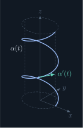
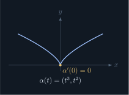
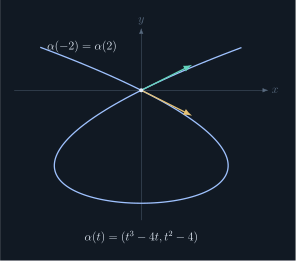
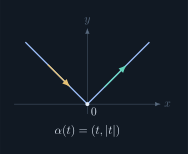
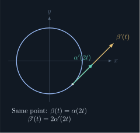

## Smoothness convention

In these notes, following do Carmo, **differentiable** means **smooth**: derivatives of every order exist. This is stronger than merely having a first derivative. For a map into Euclidean space, smoothness is checked coordinate by coordinate.

::: definition [1.2.1] Parametrized differentiable curve
A **parametrized differentiable curve** is a smooth map

$$
\alpha:I\longrightarrow\R^3,\qquad
\alpha(t)=(x(t),y(t),z(t)),
$$

where $I=(a,b)$ is an open interval and $x,y,z$ are smooth real functions. The parameter $t$ labels points along the map. Either endpoint may be infinite, including the case $I=\R$.
:::

Planar examples can be written as maps into $\R^2$, or embedded in $\R^3$ by adding a zero third coordinate.

::: definition [1.2.2] Velocity and trace
The **velocity vector**, also called the tangent vector at parameter $t$, is

$$
\alpha'(t)=(x'(t),y'(t),z'(t)).
$$

The **trace** is the image set

$$
\alpha(I)=\{\alpha(t):t\in I\}.
$$

The curve is a map; its trace is a set of points. A smooth curve may have zero velocity or revisit the same point.
:::

## Five examples

### 1. A helix

For $a>0$ and real $b$, let

$$
\begin{aligned}
&\alpha(t)=(a\cos t,a\sin t,bt),\qquad t\in\R,\\
&\alpha'(t)=(-a\sin t,a\cos t,b).
\end{aligned}
$$

Its trace lies on $x^2+y^2=a^2$. Increasing $t$ by $2\pi$ completes one turn in the horizontal projection and changes height by $2\pi b$. For $b\ne0$ this gives a helix; the unsigned vertical spacing per turn is $2\pi|b|$. If $b=0$, the trace is a circle.

### 2. A smooth map with a cusp in its trace

$$
\begin{aligned}
&\alpha(t)=(t^3,t^2),\\
&\alpha'(t)=(3t^2,2t),\qquad\alpha'(0)=(0,0).
\end{aligned}
$$

Both coordinates are polynomials, so the map is smooth even at $t=0$. Its trace satisfies $x^2=y^3$ and $y\ge0$, producing a cusp at the origin. Smoothness of the map alone does not require nonzero velocity.

### 3. A self-intersection

Let $\alpha(t)=(t^3-4t,t^2-4)$. Then

$$
\alpha(2)=\alpha(-2)=(0,0).
$$

Different parameter values can therefore give the same point. In fact, the velocities there are $(8,4)$ and $(8,-4)$, describing different tangent directions. A parametrized differentiable curve need not be injective.

### 4. A map that is not differentiable

For $\alpha(t)=(t,|t|)$, the second coordinate has unequal one-sided derivatives at $0$. Hence this map on $\R$ is not a parametrized differentiable curve under the definition above.

### 5. Same trace, different parametrizations

Consider the maps on $\R$

$$
\begin{aligned}
&\alpha(t)=(\cos t,\sin t),\\
&\beta(t)=(\cos 2t,\sin 2t)=\alpha(2t).
\end{aligned}
$$

Both traces are the unit circle. However, their speeds are $\|\alpha'(t)\|=1$ and $\|\beta'(t)\|=2$. The map $\beta$ takes half as much parameter time to make one revolution.

::: remark [1.2.1] Compare velocities at matching points
The chain rule gives $\beta'(t)=2\alpha'(2t)$, not generally $2\alpha'(t)$. At the corresponding point $\beta(t)=\alpha(2t)$, the velocity of $\beta$ is twice that of $\alpha$. At the same numerical parameter value, the points and velocity directions may differ.
:::

## Pictures of the examples

<figure class="math-note-figure">

<figcaption><strong>Example 1 · Helix</strong>

A smooth spatial curve winding around a cylinder.

</figcaption>
</figure>

<figure class="math-note-figure">

<figcaption><strong>Example 2 · Zero velocity</strong>

A smooth parametrization can have a cusp in its trace.

</figcaption>
</figure>

<figure class="math-note-figure">

<figcaption><strong>Example 3 · Repeated point</strong>

One trace point can correspond to two parameter values and distinct velocities.

</figcaption>
</figure>

<figure class="math-note-figure">

<figcaption><strong>Example 4 · Corner</strong>

The coordinate $|t|$ prevents this parametrization from being differentiable at zero.

</figcaption>
</figure>

<figure class="math-note-figure">

<figcaption><strong>Example 5 · Same trace, different speed</strong>

Compare matching points: $\beta(t)=\alpha(2t)$ and $\beta'(t)=2\alpha'(2t)$.

</figcaption>
</figure>

## Norm and inner product in real three-dimensional space

::: definition [1.2.3] Norm and dot product
For $u=(u_1,u_2,u_3)\in\R^3$, its **norm** or **length** is

$$
\|u\|=\sqrt{u_1^2+u_2^2+u_3^2}.
$$

For $u,v\in\R^3$, their **dot product** is

$$
u\cdot v=u_1v_1+u_2v_2+u_3v_3.
$$

If both vectors are nonzero and their angle is $\theta\in[0,\pi]$, the geometric expression is

$$
u\cdot v=\|u\|\,\|v\|\cos\theta.
$$

The coordinate formula also applies when either vector is zero; an angle with the zero vector is not defined.
:::

::: proposition [1.2.1] Dot-product properties
For $u,v,w\in\R^3$ and $\lambda\in\R$:

**Orthogonality**

For nonzero $u,v$, we have $u\cdot v=0$ exactly when their angle is $\pi/2$.

**Symmetry**

$$
u\cdot v=v\cdot u.
$$

**Scalar compatibility**

$$
\lambda(u\cdot v)=(\lambda u)\cdot v=u\cdot(\lambda v).
$$

**Additivity**

$$
u\cdot(v+w)=u\cdot v+u\cdot w.
$$

:::

Why the coordinate formula matches the geometric picture

For the standard basis $e_1=(1,0,0)$, $e_2=(0,1,0)$, and $e_3=(0,0,1)$, we have $e_i\cdot e_j=1$ when $i=j$ and $0$ otherwise. Expand $u=\sum_i u_ie_i$ and $v=\sum_j v_je_j$ using linearity:

$$
u\cdot v=\sum_{i=1}^3\sum_{j=1}^3u_iv_j(e_i\cdot e_j)
=\sum_{i=1}^3u_iv_i.
$$

Only matching basis directions contribute. $\blacksquare$

## Differentiating a dot product

::: proposition [1.2.2] Product rule for vector-valued maps
For smooth maps $u,v:I\to\R^3$,

$$
\frac{d}{dt}\bigl(u(t)\cdot v(t)\bigr)
=u'(t)\cdot v(t)+u(t)\cdot v'(t).
$$
:::

Proof: apply the scalar product rule coordinatewise

Write $u\cdot v=\sum_{k=1}^3u_kv_k$. Differentiating each scalar product gives

$$
\frac{d}{dt}\sum_{k=1}^3u_kv_k
=\sum_{k=1}^3(u_k'v_k+u_kv_k')
=u'\cdot v+u\cdot v'.
$$

This reduces vector differentiation to ordinary calculus. $\blacksquare$

## What to remember

A curve carries both a trace and a parametrization. The parametrization determines velocity, so two maps with the same trace can have different speeds. Smoothness, nonzero velocity, and injectivity are separate conditions.
