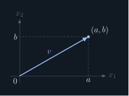
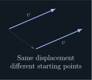
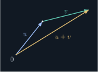
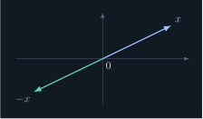
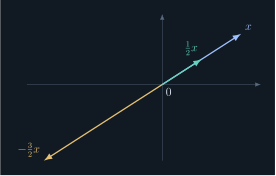

## Scalars and coordinates

Fix a positive integer $n$. As before, $\mathbb F$ denotes either $\R$ or $\C$.

::: definition [1.1.3.1] The space of lists and coordinates
The set **$\mathbb F^n$** consists of all length-$n$ lists with entries in $\mathbb F$:

$$
\mathbb F^n=\{(x_1,\ldots,x_n):x_k\in\mathbb F\text{ for }k=1,\ldots,n\}.
$$

For $x=(x_1,\ldots,x_n)$, the entry $x_k$ is its **$k$th coordinate**. We call $x$ a **vector**; each coordinate is a scalar.
:::

### Example

An element of $\C^4$ has four complex coordinates. For instance,

$$
(1+i,\,0,\,-2i,\,3)\in\C^4.
$$

Choosing $\mathbb F=\R$ and $n=2$ or $3$ recovers the plane or ordinary three-dimensional space. Higher-dimensional lists remain well-defined even when we cannot draw them.

## Addition

::: definition [1.1.3.2] Addition in the space of lists
**Vector addition** combines corresponding coordinates. For $x,y\in\mathbb F^n$,

$$
\begin{aligned}
&x=(x_1,\ldots,x_n),\qquad y=(y_1,\ldots,y_n),\\
&x+y=(x_1+y_1,\ldots,x_n+y_n).
\end{aligned}
$$

:::

::: proposition [1.1.3.1] Commutativity of vector addition
For any $x,y\in\mathbb F^n$,

$$
x+y=y+x.
$$
:::

Proof: addition is commutative

Write $x=(x_1,\ldots,x_n)$ and $y=(y_1,\ldots,y_n)$. Each coordinate sum can be reversed because scalar addition is commutative:

$$
\begin{aligned}
&x+y=(x_1+y_1,\ldots,x_n+y_n)\\
&\phantom{x+y}=(y_1+x_1,\ldots,y_n+x_n)\\
&\phantom{x+y}=y+x.
\end{aligned}
$$

Thus every corresponding coordinate agrees, proving equality of the two lists. $\blacksquare$

::: definition [1.1.3.3] Zero vector
The **zero vector** is the list containing $n$ scalar zeros:

$$
0=(0,\ldots,0)\in\mathbb F^n.
$$

Coordinatewise addition gives $x+0=x$ for every $x\in\mathbb F^n$.
:::

::: remark [1.1.3.1] The meaning of zero depends on context
In $0=(0,\ldots,0)$, the left-hand zero is a vector; each entry on the right is a scalar. In $x+0=x$, the addition is vector addition, so $0$ denotes the zero vector.
:::

## Additive inverses

::: definition [1.1.3.4] Additive inverse of a vector
For $x=(x_1,\ldots,x_n)$, its **additive inverse** is

$$
-x=(-x_1,\ldots,-x_n).
$$

It satisfies $x+(-x)=0$, where the right-hand side is the zero vector. It is unique: if $x+y=0$, then each coordinate obeys $y_k=-x_k$.
:::

## Scalar multiplication

::: definition [1.1.3.5] Scalar multiplication
For a scalar $\lambda\in\mathbb F$ and a vector $x\in\mathbb F^n$, **scalar multiplication** acts on every coordinate:

$$
\lambda(x_1,\ldots,x_n)=(\lambda x_1,\ldots,\lambda x_n).
$$

The result is another vector in $\mathbb F^n$.
:::

### Worked example

Let $x=(2,-1,3)$ and $y=(1,4,-2)$ in $\R^3$.

$$
\begin{aligned}
&x+y=(3,3,1),\\
&-x=(-2,1,-3),\\
&2x=(4,-2,6).
\end{aligned}
$$

## Geometric intuition in the real plane

- A pair $(a,b)$ can describe a point or the displacement arrow from the origin to that point.
- Moving an arrow without changing its direction or length represents the same vector.
- To picture $u+v$, place the tail of $v$ at the tip of $u$. The combined displacement is their sum.
- The arrow for $-x$ has the same length as $x$ and points in the opposite direction.
- For real $\lambda>0$, multiplication preserves direction and scales length by $\lambda$. For $\lambda<0$, it reverses direction and scales length by $|\lambda|$. For $\lambda=0$, the result is the zero vector.

<figure class="math-note-figure">

<figcaption><strong>A vector and its coordinates</strong>

The point $(a,b)$ also describes a displacement vector from the origin.

</figcaption>
</figure>

<figure class="math-note-figure">

<figcaption><strong>The same vector, translated</strong>

Parallel translation changes the starting point, not the vector.

</figcaption>
</figure>

<figure class="math-note-figure">

<figcaption><strong>Head-to-tail addition</strong>

Place $v$ at the tip of $u$; the overall displacement is $u+v$.

</figcaption>
</figure>

<figure class="math-note-figure">

<figcaption><strong>A vector and its inverse</strong>

$x$ and $-x$ have equal length and opposite directions.

</figcaption>
</figure>

<figure class="math-note-figure">

<figcaption><strong>Scaling by real numbers</strong>

Positive factors preserve direction; negative factors reverse it.

</figcaption>
</figure>

::: remark [1.1.3.2] Pictures support the algebra
These arrow descriptions concern real vectors, especially $\R^2$. They do not replace the coordinate definitions. A complex scalar can rotate as well as scale, so the positive/negative description above is specifically for real scalars.
:::

::: remark [1.1.3.3] Scalar multiplication is not a dot product
Scalar multiplication takes one scalar and one vector and returns a vector. A dot product combines two vectors and returns a scalar. Coordinatewise multiplication of two vectors is another possible operation, but it is not the scalar multiplication defined here.
:::
